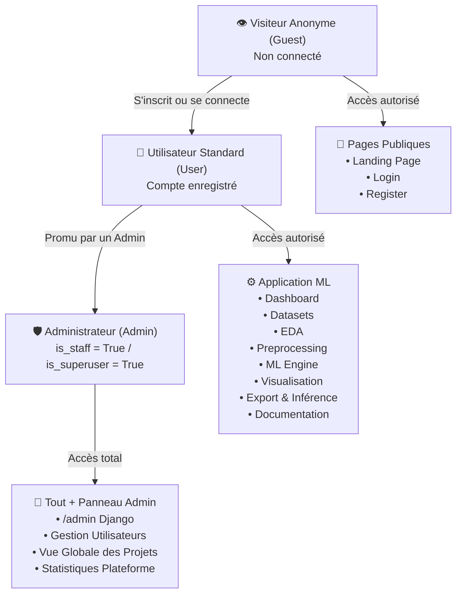

# 🔐 Authentification & Acteurs — ML Studio

> **Document de référence** pour l'implémentation du système d'authentification et la définition des droits d'accès par rôle utilisateur.  
> **Basé sur :** Django `contrib.auth` (natif) + système de permissions.  
> **Auteur :** Équipe ML Studio  
> **Dernière mise à jour :** Novembre 2026

---

## 📑 Sommaire

1. [Vue d'ensemble des acteurs](#1-vue-densemble-des-acteurs)
2. [Acteur 1 — Administrateur (Admin)](#2-acteur-1--administrateur-admin)
3. [Acteur 2 — Utilisateur Standard (User)](#3-acteur-2--utilisateur-standard-user)
4. [Acteur 3 — Visiteur Anonyme (Guest)](#4-acteur-3--visiteur-anonyme-guest)
5. [Matrice des permissions par page](#5-matrice-des-permissions-par-page)
6. [Pages d'authentification à créer](#6-pages-dauthentification-à-créer)
7. [Structure Django recommandée](#7-structure-django-recommandée)
8. [Flux d'authentification (User Journey)](#8-flux-dauthentification-user-journey)

---

## 1. Vue d'ensemble des acteurs



---

## 2. Acteur 1 — Administrateur (Admin)

### 🛡️ Profil

| Attribut | Valeur Django |
|----------|--------------|
| Modèle Django | `User` avec `is_staff=True` et `is_superuser=True` |
| Création | Via `python manage.py createsuperuser` |
| Identification | Badge **"Admin"** visible dans la sidebar |

### ✅ Pages & Fonctionnalités accessibles

#### Panneau d'administration Django (`/admin`)
- 👥 **Gestion des utilisateurs** : Créer, modifier, désactiver, supprimer des comptes
- 🔐 **Gestion des permissions** : Attribuer / révoquer le statut `is_staff`
- 📂 **Vue globale des datasets** : Voir tous les datasets uploadés par tous les utilisateurs
- 🤖 **Vue globale des modèles entraînés** : Accéder aux métadonnées de tous les modèles
- 📊 **Statistiques plateforme** : Nombre d'utilisateurs actifs, datasets enregistrés, modèles créés

#### Tableau de bord Admin (`/dashboard` — vue enrichie)
- 📈 **Statistiques globales** affichées en haut du dashboard :
  - Nombre total d'utilisateurs inscrits
  - Nombre total de datasets sur la plateforme
  - Nombre total de modèles entraînés
  - Espace disque utilisé (`media/`)
- 🔍 **Accès en lecture** aux projets de n'importe quel utilisateur (si nécessaire pour support)

#### Toutes les fonctionnalités utilisateur standard
- L'Admin peut aussi utiliser l'application comme un utilisateur normal (upload, ML, export, etc.)

### ❌ Restrictions
- Aucune restriction. L'Admin a un accès total à toute la plateforme.

---

## 3. Acteur 2 — Utilisateur Standard (User)

### 👤 Profil

| Attribut | Valeur Django |
|----------|--------------|
| Modèle Django | `User` avec `is_staff=False`, `is_superuser=False` |
| Création | Via la page d'inscription (`/auth/register`) |
| Isolation | Ne voit que **ses propres** données |

### ✅ Pages & Fonctionnalités accessibles

#### 🏠 Dashboard (`/dashboard`)
- Vue d'accueil personnalisée : **"Bonjour, [prénom] 👋"**
- Carte **"Mes Projets Récents"** : Liste des derniers datasets et modèles entraînés
- Bouton **"Nouveau Projet"** → redirige vers l'import de dataset
- Stepper horizontal indiquant la progression en cours
- Accès rapide à la documentation

#### 📂 Datasets (`/datasets`)
- ⬆️ **Upload** : Importer un fichier CSV, Excel, JSON ou par URL
- 🗂️ **Datasets démo** : Charger Iris, Titanic, Housing, Wine (partagés, lecture seule)
- 📋 **Mes datasets** : Liste de ses datasets avec date d'upload, taille, nombre de lignes/colonnes
- 👁️ **Aperçu** : Prévisualisation tabulaire paginée du dataset sélectionné
- 🗑️ **Suppression** : Supprimer ses propres datasets uniquement

#### 🔬 Analyse EDA (`/eda`)
- 📊 Statistiques descriptives (moyenne, médiane, écart-type, skewness, kurtosis)
- 📉 Graphiques interactifs Plotly (histogrammes, boxplots, scatter matrix)
- 🌡️ Matrice de corrélation dynamique (heatmap)
- 🏷️ Typage automatique des colonnes avec badges (`int`, `float`, `object`, `datetime`)
- ⚠️ Indicateurs visuels de valeurs manquantes (barre de complétude par colonne)

#### ⚙️ Prétraitement (`/preprocessing`)
- 🩹 Imputation des valeurs manquantes (moyenne, médiane, mode, suppression)
- 🔡 Encodage catégoriel (One-Hot, Ordinal, Label Encoding)
- 📏 Normalisation / Standardisation (StandardScaler, MinMaxScaler, RobustScaler)
- ✂️ Séparation Train / Test (choix du ratio, seed, stratification)
- 💾 Sauvegarde du pipeline `ColumnTransformer` pour réutilisation

#### 🤖 Modélisation ML (`/ml_engine`)
- 🧠 Sélection parmi les **11 algorithmes** disponibles
- 🎛️ Configuration des hyperparamètres via le tiroir latéral (Drawer)
- ▶️ Lancement de l'entraînement avec logs en direct
- 📊 Résultats de la validation croisée (K-Fold)
- 🏆 Leaderboard comparatif de ses modèles

#### 📈 Visualisation ML (`/model_viz`)
- 🎯 Matrice de confusion interactive
- 📉 Courbe ROC / AUC
- 📊 Graphique des résidus (régression)
- 🌲 Visualisation de l'arbre de décision
- 🔵 Projection PCA 2D (clustering K-Means)
- ⭐ Importance des features (Random Forest, etc.)
- 📉 Courbe de convergence de perte (MLP / Réseau de Neurones)

#### 📤 Export & Inférence (`/export_inference`)
- 💾 Télécharger le modèle entraîné (`.joblib` / `.pkl`)
- 📄 Télécharger les prédictions sur le jeu de test (`.csv`)
- 📋 Générer et télécharger le rapport PDF d'analyse complet
- 🧪 **Inference Playground** : Formulaire dynamique pour prédire sur de nouvelles données

#### 📚 Documentation (`/docs`)
- 📖 Fiches théoriques des 11 algorithmes (formules KaTeX, cas d'usage)
- 🎓 Tutoriels guidés interactifs pas à pas
- ❓ FAQ et conseils de bonnes pratiques ML

#### 👤 Profil & Paramètres (`/auth/profile`)
- ✏️ Modifier son nom, prénom, email
- 🔑 Changer son mot de passe
- 🗑️ Supprimer son compte

### ❌ Restrictions
- ❌ Ne peut **pas** accéder au panneau `/admin`
- ❌ Ne peut **pas** voir les données des autres utilisateurs
- ❌ Ne peut **pas** modifier ou supprimer les datasets des autres

---

## 4. Acteur 3 — Visiteur Anonyme (Guest)

### 👁️ Profil

| Attribut | Valeur |
|----------|--------|
| Statut Django | Non authentifié (`request.user.is_authenticated = False`) |
| Pas de compte | Peut naviguer sur les pages publiques uniquement |

### ✅ Pages accessibles (publiques)

| Page | URL | Description |
|------|-----|-------------|
| **Landing Page** | `/` | Présentation de l'application, fonctionnalités, CTA "Se connecter" / "S'inscrire" |
| **Page de connexion** | `/auth/login` | Formulaire email + mot de passe |
| **Page d'inscription** | `/auth/register` | Formulaire nom, prénom, email, mot de passe |
| **Page "Mot de passe oublié"** | `/auth/password-reset` | Envoi d'un lien de réinitialisation |

### ❌ Restrictions
- ❌ Toute tentative d'accès à `/dashboard`, `/datasets`, `/eda`, etc. → **redirection automatique vers `/auth/login`**
- ❌ Aucun accès aux fonctionnalités ML

---

## 5. Matrice des permissions par page

| Page / URL | 👁️ Guest | 👤 User | 🛡️ Admin |
|------------|----------|---------|---------|
| `/` — Landing Page | ✅ | ✅ | ✅ |
| `/auth/login` | ✅ | ➡️ Redirigé vers dashboard | ➡️ Redirigé vers dashboard |
| `/auth/register` | ✅ | ➡️ Redirigé vers dashboard | ➡️ Redirigé vers dashboard |
| `/auth/profile` | ❌ → login | ✅ (ses données) | ✅ |
| `/dashboard` | ❌ → login | ✅ (ses projets) | ✅ (stats globales) |
| `/datasets` | ❌ → login | ✅ (ses datasets) | ✅ (tous les datasets) |
| `/eda` | ❌ → login | ✅ | ✅ |
| `/preprocessing` | ❌ → login | ✅ | ✅ |
| `/ml_engine` | ❌ → login | ✅ | ✅ |
| `/model_viz` | ❌ → login | ✅ | ✅ |
| `/export_inference` | ❌ → login | ✅ (ses modèles) | ✅ |
| `/docs` | ❌ → login | ✅ | ✅ |
| `/admin` | ❌ → login | ❌ Interdit (403) | ✅ Accès total |

---

## 6. Pages d'authentification à créer

### 6.1 Landing Page — `/`
**Fichier :** `templates/auth/landing.html`

**Contenu :**
- Header avec logo ML Studio + boutons **"Se connecter"** et **"S'inscrire"**
- Section Hero : titre accrocheur, sous-titre, illustration/mockup de l'app
- Section Features : 6 cartes présentant les fonctionnalités clés (EDA, 11 algos, Plotly, Export PDF, etc.)
- Section "Comment ça marche" : stepper visuel en 6 étapes
- Footer avec liens utiles

---

### 6.2 Page de Connexion — `/auth/login`
**Fichier :** `templates/auth/login.html`

**Contenu :**
```
[ Logo ML Studio ]
[ Titre : "Bon retour 👋" ]
[ Sous-titre : "Connectez-vous pour accéder à votre workspace" ]

Champ : Email / Username
Champ : Mot de passe (avec œil pour afficher/masquer)
Lien : "Mot de passe oublié ?"
Bouton : [ Se connecter ] (Indigo, pleine largeur)
Lien : "Pas encore de compte ? S'inscrire"
```

---

### 6.3 Page d'Inscription — `/auth/register`
**Fichier :** `templates/auth/register.html`

**Contenu :**
```
[ Logo ML Studio ]
[ Titre : "Créer un compte" ]

Champ : Prénom
Champ : Nom
Champ : Email
Champ : Mot de passe
Champ : Confirmer le mot de passe
Bouton : [ Créer mon compte ] (Indigo, pleine largeur)
Lien : "Déjà un compte ? Se connecter"
```

---

### 6.4 Page de Profil — `/auth/profile`
**Fichier :** `templates/auth/profile.html`

**Contenu :**
- Avatar / initiales de l'utilisateur
- Formulaire de modification des informations personnelles
- Section de changement de mot de passe
- Statistiques personnelles : nbre de datasets, nbre de modèles entraînés, date d'inscription
- Zone de danger : bouton "Supprimer mon compte" (avec confirmation)

---

### 6.5 Page "Mot de passe oublié" — `/auth/password-reset`
**Fichier :** `templates/auth/password_reset.html`

**Contenu :**
- Champ email
- Message de confirmation d'envoi
- *(Utilise le système Django built-in de réinitialisation par email)*

---

## 7. Structure Django recommandée

### 7.1 App Django à créer : `apps/accounts`

```text
apps/
└── accounts/
    ├── __init__.py
    ├── models.py          # Profil étendu (optionnel) : avatar, bio
    ├── forms.py           # RegisterForm, LoginForm, ProfileForm
    ├── views.py           # register, login, logout, profile, password_reset
    ├── urls.py            # Routes auth
    └── decorators.py      # @admin_required (en complément de @login_required)
```

### 7.2 URLs d'authentification

```python
# apps/accounts/urls.py
from django.urls import path
from . import views

urlpatterns = [
    path('login/',          views.login_view,     name='login'),
    path('register/',       views.register_view,  name='register'),
    path('logout/',         views.logout_view,    name='logout'),
    path('profile/',        views.profile_view,   name='profile'),
    path('password-reset/', views.password_reset, name='password_reset'),
]
```

### 7.3 Décorateurs de protection des vues

```python
# Protection standard (User connecté)
from django.contrib.auth.decorators import login_required

@login_required(login_url='/auth/login/')
def dashboard(request):
    ...

# Protection Admin uniquement
from django.contrib.auth.decorators import user_passes_test

def admin_required(view_func):
    return user_passes_test(
        lambda u: u.is_staff,
        login_url='/auth/login/'
    )(view_func)

@admin_required
def admin_panel(request):
    ...
```

### 7.4 Lier les données à l'utilisateur

```python
# apps/datasets/models.py
from django.contrib.auth.models import User

class Dataset(models.Model):
    user       = models.ForeignKey(User, on_delete=models.CASCADE, related_name='datasets')
    name       = models.CharField(max_length=255)
    file       = models.FileField(upload_to='datasets/')
    file_type  = models.CharField(max_length=10)  # csv, xlsx, json
    rows       = models.IntegerField(default=0)
    columns    = models.IntegerField(default=0)
    created_at = models.DateTimeField(auto_now_add=True)

    class Meta:
        ordering = ['-created_at']

    def __str__(self):
        return f"{self.name} ({self.user.username})"
```

### 7.5 Settings Django nécessaires

```python
# ml_studio/settings.py

INSTALLED_APPS = [
    ...
    'django.contrib.auth',         # ✅ Déjà natif
    'django.contrib.messages',     # ✅ Pour les flash messages
    'apps.accounts',               # ➕ Notre app auth custom
]

# Redirection après login/logout
LOGIN_URL          = '/auth/login/'
LOGIN_REDIRECT_URL = '/dashboard/'
LOGOUT_REDIRECT_URL = '/'

# Sessions : durée de vie
SESSION_COOKIE_AGE = 86400 * 7  # 7 jours
SESSION_SAVE_EVERY_REQUEST = True
```

---

## 8. Flux d'authentification (User Journey)

```mermaid
flowchart TD
    A["🌐 Visite /"] --> B{Connecté ?}

    B -->|Non| C["👁️ Landing Page (/)"]
    C --> D{Choix}
    D -->|"Se connecter"| E["📄 Login (/auth/login)"]
    D -->|"S'inscrire"| F["📄 Register (/auth/register)"]

    E -->|"Credentials valides"| G["🏠 Dashboard (/dashboard)"]
    E -->|"Credentials invalides"| E_ERR["❌ Erreur affichée\n(Message Django)"]
    E_ERR --> E

    F -->|"Formulaire valide"| G
    F -->|"Erreur (email dupliqué, etc.)"| F_ERR["❌ Erreur affichée"]
    F_ERR --> F

    B -->|Oui (User standard)| G

    G --> H{Rôle ?}
    H -->|"👤 User"| I["⚙️ Workflow ML Normal\nDatasets → EDA → Preprocessing\n→ ML Engine → Export"]
    H -->|"🛡️ Admin"| J["⚙️ Workflow ML + Stats Globales\n+ Accès /admin Django"]

    I --> K["🚪 Logout → Retour Landing Page"]
    J --> K
```

---

## 🗒️ Notes pour l'implémentation

> [!IMPORTANT]
> **Priorité d'implémentation recommandée :**
> 1. Créer l'app `accounts` et les vues `register`, `login`, `logout`
> 2. Protéger toutes les vues existantes avec `@login_required`
> 3. Lier les modèles `Dataset` et les sessions ML à `request.user`
> 4. Ajouter le dashboard enrichi Admin (stats globales)
> 5. Créer la Landing Page publique en dernier (cosmétique)

> [!TIP]
> **Django Admin gratuit :** Le panneau `/admin` est **déjà fonctionnel** dès que `is_staff=True`. Il suffit de créer un superuser avec `python manage.py createsuperuser` — pas besoin de coder un panneau admin from scratch.

> [!NOTE]
> **Modèle utilisateur :** Utiliser le modèle `User` natif de Django suffit pour ce projet. Un `Profile` étendu (avatar, bio) peut être ajouté via un `OneToOneField` si souhaité, mais reste optionnel.
