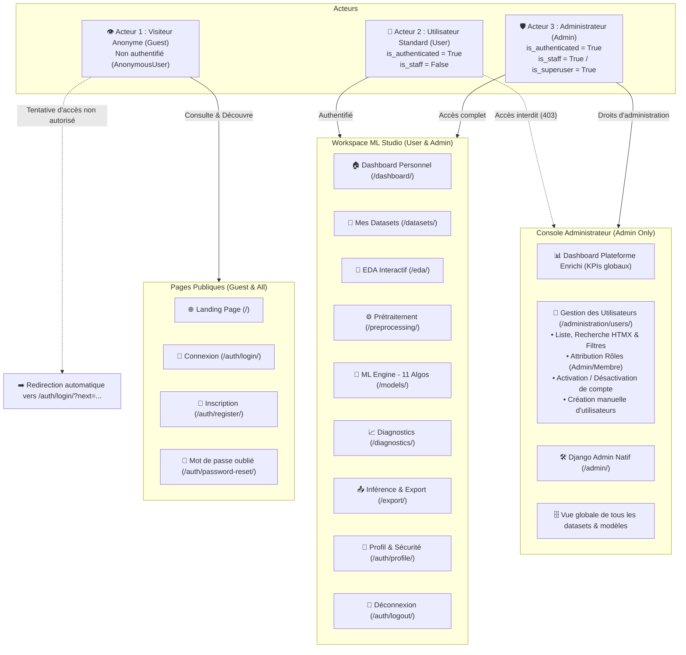

# 🏛️ Architecture Globale & Définition des Acteurs — ML Studio

> **Emplacement :** `planning/acteurs_planning/00_overview_and_architecture.md`  
> **Contexte :** Système d'Authentification, Gestion des Rôles (RBAC) & Sécurisation de la Plateforme  
> **Contrainte académique :** **100% Python / Django 5.x**, zéro dépendance Node.js/npm.  
> **Design standard :** Thème sombre "Linear / Notion / Omakase" (fond `#111010`, surfaces `#1B1918`, accents `#B8323C` & Indigo `#6366f1`).

---

## 1. Vision & Objectifs de l'Expert

L'objectif de cette refonte est de transformer ML Studio d'un prototype monoposte en une **véritable plateforme SaaS multi-utilisateurs sécurisée**, tout en préservant la simplicité et la performance de l'écosystème Django natif.

### Piliers Fondamentaux :
1. **Cloisonnement Strict des Données (Multi-Tenancy par Utilisateur) :** Chaque utilisateur possède ses propres datasets, ses pipelines de prétraitement et ses modèles entraînés. Aucun utilisateur ne peut voir ou altérer les données d'un tiers.
2. **Gestion Granulaire des Rôles (RBAC) :** Différenciation nette entre le **Visiteur Anonyme (Guest)**, l'**Utilisateur Standard (User)**, et l'**Administrateur (Admin)**.
3. **Persistance Base de Données 100% Fiable :** Liaison directe des datasets et des artefacts de modèles à la base de données SQLite/PostgreSQL via l'ORM Django, remplaçant la dépendance exclusive aux sessions éphémères.
4. **Expérience Utilisateur Fluide & Moderne :** Formulaires réactifs et sans rechargement lourd grâce à **HTMX**, micro-interactions (toggle mot de passe, modales de confirmation) propulsées par **Alpine.js**, et intégration native du profil et de la déconnexion dans l'interface (Sidebar & Topbar).

---

## 2. Cartographie Globale des 3 Acteurs

---

## 3. Définition Détaillée des Profils & Responsabilités

### 👁️ Acteur 1 : Le Visiteur Anonyme (Guest)
* **Définition Django :** `request.user.is_authenticated == False`.
* **Rôle :** Découvrir la valeur ajoutée de ML Studio, comprendre le fonctionnement des 11 algorithmes et s'inscrire ou se connecter.
* **Périmètre Accessible :**
  - `/` : Landing Page vitrine avec présentation des fonctionnalités, aperçus interactifs, avis/témoignages et appels à l'action (CTA).
  - `/auth/login/` : Page d'authentification avec lien vers mot de passe oublié et inscription.
  - `/auth/register/` : Page de création de compte avec validation instantanée.
  - `/auth/password-reset/` : Procédure de récupération par email.
* **Garde-fous & Sécurité :**
  - Redirection automatique vers `/auth/login/?next=<path>` pour toute tentative d'accès à l'espace de travail.
  - Aucun accès en lecture ni en écriture aux datasets stockés dans `media/`.

---

### 👤 Acteur 2 : L'Utilisateur Standard (User)
* **Définition Django :** `request.user.is_authenticated == True`, `request.user.is_staff == False`.
* **Rôle :** Importer ses données, explorer, entraîner des modèles et exporter ses résultats en autonomie complète.
* **Périmètre Accessible :**
  - **Dashboard personnel (`/dashboard/`) :** Salutation dynamique ("Bonjour, [Prénom]"), statut du projet courant, raccourcis rapides.
  - **Gestionnaire de Datasets (`/datasets/`) :** Upload de ses fichiers, accès aux jeux de démonstration (Iris, Titanic, Housing, Wine) en lecture partagée, prévisualisation de ses propres données.
  - **Pipeline ML (Étapes 2 à 6) :** EDA Plotly, Prétraitement sans data leakage, entraînement des 11 algorithmes, visualisations diagnostiques (ROC, Confusion Matrix, Résidus), export Joblib et Inférence dynamique.
  - **Espace Profil (`/auth/profile/`) :** Modification des coordonnées, changement de mot de passe, métriques personnelles (nombre de modèles entraînés, espace utilisé), suppression du compte.
  - **Déconnexion sécurisée (`/auth/logout/`) :** Accessible en un clic depuis le haut de page (Topbar) et le bas de la barre latérale (Sidebar).
* **Isolation des Données (Multi-Tenancy) :**
  - `Dataset.objects.filter(user=request.user)` garantit qu'aucun autre utilisateur standard ne peut voir, télécharger ou supprimer ses fichiers.

---

### 🛡️ Acteur 3 : L'Administrateur (Admin)
* **Définition Django :** `request.user.is_staff == True` et/ou `request.user.is_superuser == True`.
* **Rôle :** Superviser l'infrastructure, monitorer l'activité globale, administrer les utilisateurs et garantir l'intégrité de la plateforme.
* **Périmètre Accessible :**
  - **Toutes les fonctionnalités de l'Utilisateur Standard** (peut entraîner des modèles et uploader ses datasets).
  - **Badge visuel "Admin"** : Affiché en évidence dans la barre latérale et le menu profil.
  - **Console d'Administration Django (`/admin/`) :** Interface d'administration native avec accès direct aux tables `User`, `Dataset`, `UserProfile`, `ModelArtifact`.
  - **Dashboard Métriques Système (`/dashboard/`) :**
    - 📈 Nombre total d'utilisateurs inscrits et actifs.
    - 🗂️ Nombre global de datasets hébergés sur le disque.
    - 🤖 Nombre total de modèles entraînés.
    - 💾 Consommation d'espace disque globale du dossier `media/`.
  - **Droits de modération :** Possibilité d'inspecter un dataset pour assister un utilisateur en difficulté ou purger les fichiers obsolètes.

---

## 4. Matrice Globale des Permissions par Endpoint

| Route URL | Nom de Route | 👁️ Guest | 👤 User | 🛡️ Admin |
| :--- | :--- | :---: | :---: | :---: |
| `/` | `core:landing` | ✅ Page publique | ➡️ Redirection `/dashboard/` | ➡️ Redirection `/dashboard/` |
| `/auth/login/` | `accounts:login` | ✅ Formulaire | ➡️ Redirection `/dashboard/` | ➡️ Redirection `/dashboard/` |
| `/auth/register/` | `accounts:register` | ✅ Formulaire | ➡️ Redirection `/dashboard/` | ➡️ Redirection `/dashboard/` |
| `/auth/logout/` | `accounts:logout` | ❌ Inaccessible | ✅ Déconnexion POST | ✅ Déconnexion POST |
| `/auth/profile/` | `accounts:profile` | ❌ ➡️ `/auth/login/` | ✅ Profil personnel | ✅ Profil + Badges |
| `/auth/password-reset/` | `accounts:password_reset`| ✅ Formulaire | ✅ Accessible | ✅ Accessible |
| `/dashboard/` | `core:dashboard` | ❌ ➡️ `/auth/login/` | ✅ Projets personnels | ✅ Projets + KPIs Globaux |
| `/datasets/` | `datasets:index` | ❌ ➡️ `/auth/login/` | ✅ Ses datasets | ✅ Tous les datasets |
| `/eda/` | `eda:index` | ❌ ➡️ `/auth/login/` | ✅ EDA projet actif | ✅ EDA projet actif |
| `/preprocessing/` | `preprocessing:index` | ❌ ➡️ `/auth/login/` | ✅ Pipeline actif | ✅ Pipeline actif |
| `/models/` | `ml_engine:index` | ❌ ➡️ `/auth/login/` | ✅ Ses modèles | ✅ Ses modèles |
| `/diagnostics/` | `model_viz:index` | ❌ ➡️ `/auth/login/` | ✅ Ses graphiques | ✅ Ses graphiques |
| `/export/` | `export_inference:index`| ❌ ➡️ `/auth/login/` | ✅ Ses exports | ✅ Ses exports |
| `/docs/` | `docs_tutorials:index` | ❌ ➡️ `/auth/login/` | ✅ Fiches & Tours | ✅ Fiches & Tours |
| `/administration/users/` | `accounts:admin_users` | ❌ ➡️ `/auth/login/` | ⛔ Erreur 403 (Interdit) | ✅ Interface SaaS Gestion Utilisateurs |
| `/admin/` | `admin:index` | ❌ ➡️ `/auth/login/` | ⛔ Erreur 403 (Interdit) | ✅ Console complète Django |

---

## 5. Principes Techniques de Réalisation

1. **Architecture en Couches (Service Layer) :**  
   Les vues dans `apps/accounts/views.py` demeurent de simples contrôleurs HTTP. La logique d'authentification, de création de profil et de vérification d'unicité passe par `apps/accounts/services.py`.
2. **Protection CSRF & Sécurité des Sessions :**  
   Tous les formulaires d'authentification incluent systématiquement ``. La déconnexion s'effectue exclusivement par requête HTTP POST pour empêcher les attaques CSRF via balises `` ou liens directs.
3. **Persistance en Base de Données :**  
   Les données critiques (utilisateurs, profils, datasets associés, historique des entraînements) sont stockées dans les tables gérées par l'ORM. La session HTTP (`request.session`) ne sert qu'au pointeur contextuel du projet actif (`active_dataset_id`, `active_model_id`).
4. **Charte Graphique Unifiée (Notion / Linear Dark) :**  
   Les nouvelles interfaces d'authentification et les widgets du profil adoptent strictement la palette définie dans `templates/base.html` (couleurs Sumi, papier de riz, accent Ume rouge `#B8323C` et Indigo).

