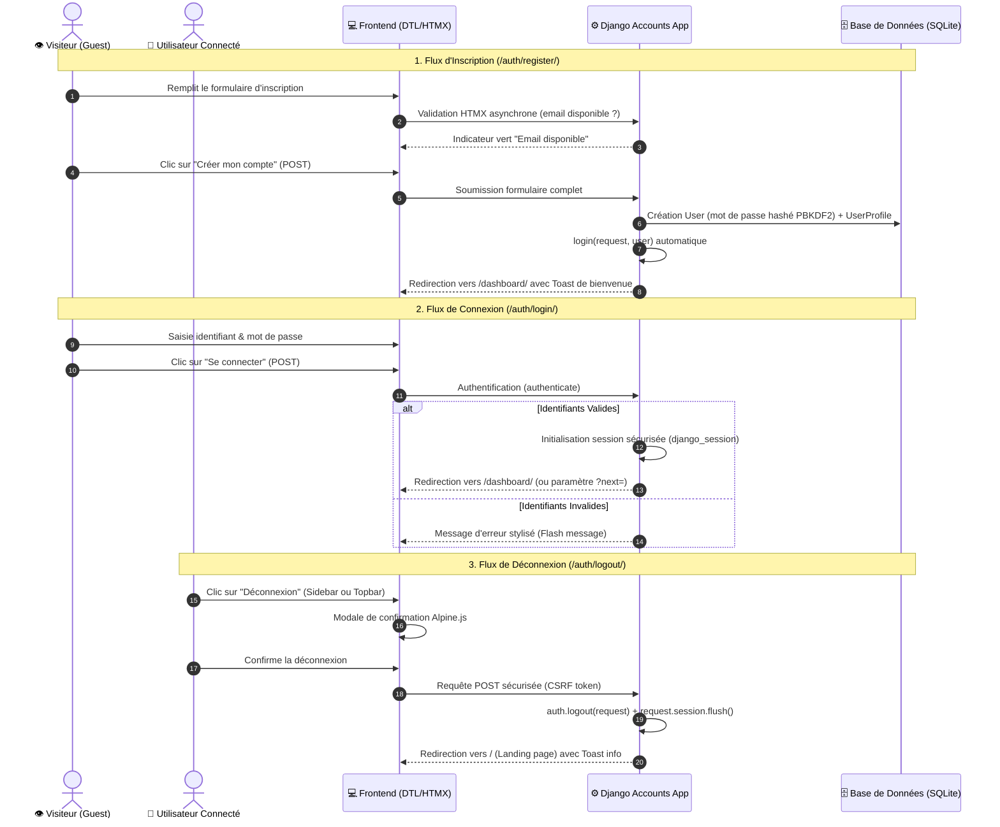

# 🔑 Flux d'Authentification & Spécifications des Pages

> **Emplacement :** `planning/acteurs_planning/01_auth_pages_and_flows.md`  
> **Composants traités :** `/auth/login/`, `/auth/register/`, `/auth/logout/`, `/auth/profile/`, `/auth/password-reset/`  
> **Frontend Stack :** Django Template Language (DTL) + Tailwind CSS + HTMX + Alpine.js.

---

## 1. Vue d'Ensemble des Flux Utilisateurs



---

## 2. Spécification Détaillée des Pages

### 2.1 Page de Connexion — `/auth/login/`

* **Template :** `templates/accounts/login.html` (hérite d'un layout épuré `templates/layouts/auth_base.html`).
* **Méthodes HTTP :** `GET` (affichage du formulaire), `POST` (traitement des identifiants).
* **Champs du formulaire :**
  1. `username_or_email` : Accepte indifféremment le nom d'utilisateur ou l'adresse email.
  2. `password` : Mot de passe masqué avec bouton œil interactif (Alpine.js) pour afficher/masquer en clair.
  3. `remember_me` : Case à cocher "Se souvenir de moi" (prolonge la durée du cookie de session à 30 jours au lieu de la session navigateur).
* **Comportements UX & Sécurité :**
  - **Prise en charge du paramètre `?next=` :** Si l'utilisateur a tenté d'accéder à `/models/` sans être connecté, il est redirigé vers `/auth/login/?next=/models/`. Après validation des credentials, la redirection s'effectue vers l'URL d'origine.
  - **Protection CSRF :** Balise `` obligatoire.
  - **Gestion des erreurs :** Message d'alerte rouge avec bordure Ume (`border-rose-600/40 bg-rose-950/20 text-rose-300`) en cas d'identifiants incorrects.
  - **Redirection si déjà connecté :** Si un utilisateur connecté accède à `/auth/login/`, il est automatiquement redirigé vers `/dashboard/`.

#### Wireframe du Formulaire de Connexion :
```text
┌─────────────────────────────────────────────────────────────┐
│                       [ Logo ML Studio ]                    │
│                        Bon retour 👋                        │
│         Connectez-vous pour accéder à votre workspace       │
│                                                             │
│  ┌─ Identifiant ou Adresse Email ────────────────────────┐  │
│  │ utilisateur@example.com                               │  │
│  └───────────────────────────────────────────────────────┘  │
│                                                             │
│  ┌─ Mot de passe ────────────────────────────────────────┐  │
│  │ •••••••••••••••••                                 👁️ │  │
│  └───────────────────────────────────────────────────────┘  │
│                                                             │
│  [✓] Se souvenir de moi           Mot de passe oublié ?     │
│                                                             │
│  ┌───────────────────────────────────────────────────────┐  │
│  │            [ Se connecter au Studio ]                 │  │
│  └───────────────────────────────────────────────────────┘  │
│                                                             │
│             Pas encore de compte ? S'inscrire               │
└─────────────────────────────────────────────────────────────┘
```

---

### 2.2 Page d'Inscription — `/auth/register/`

* **Template :** `templates/accounts/register.html`.
* **Méthodes HTTP :** `GET` (affichage), `POST` (validation et création).
* **Champs du formulaire :**
  1. `username` : Nom d'utilisateur unique (3 à 30 caractères alphanumériques).
  2. `first_name` & `last_name` : Prénom et Nom pour la personnalisation du dashboard.
  3. `email` : Adresse email professionnelle valide et unique.
  4. `password` : Mot de passe conforme aux règles de sécurité Django (8 caractères min, non trivial).
  5. `password_confirm` : Confirmation du mot de passe avec vérification d'égalité côté client/serveur.
* **Intégrations HTMX & Alpine.js :**
  - **Validation d'email en direct (HTMX) :**  
    `hx-post="" hx-trigger="blur" hx-target="#email-feedback"`  
    Affiche instantanément un checkmark vert si l'email est libre ou un avertissement ambré s'il est déjà pris.
  - **Validation d'username en direct (HTMX) :** Idem pour s'assurer que le nom d'utilisateur est disponible avant de soumettre.
  - **Jauge de robustesse du mot de passe (Alpine.js) :** Barre de progression dynamique calculant la complexité (longueur, chiffres, symboles).

---

### 2.3 Déconnexion Interne Sécurisée — `/auth/logout/`

* **Méthodes HTTP :** `POST` exclusivement (recommandation stricte Django & OWASP contre le CSRF).
* **Emplacements dans l'interface interne :**
  1. **Sidebar Navigation (Pied de barre latérale) :** Bouton rapide de déconnexion à côté des informations du compte.
  2. **Topbar Navigation (Menu Profil déroulant) :** Option "Se déconnecter" avec icône de sortie rouge.
* **Modale de Confirmation (Alpine.js) :**
  - Pour éviter les déconnexions accidentelles en plein travail d'analyse ou de modélisation, le clic ouvre une modale sobre :  
    *"Êtes-vous sûr de vouloir vous déconnecter ? Les modifications non enregistrées du pipeline en cours pourraient être réinitialisées."*
  - Boutons : `[ Annuler ]` et `[ Confirmer la déconnexion ]`.
* **Traitement Backend :**
  ```python
  from django.contrib.auth import logout
  from django.contrib import messages
  from django.shortcuts import redirect

  def logout_view(request):
      if request.method == "POST":
          logout(request)
          request.session.flush() # Purge complète de la session
          messages.info(request, "Vous avez été déconnecté avec succès. À bientôt !")
          return redirect("core:landing")
      return redirect("core:dashboard")
  ```

---

### 2.4 Page de Profil & Paramètres du Compte — `/auth/profile/`

* **Template :** `templates/accounts/profile.html`.
* **Accès :** Réservé aux utilisateurs connectés (`@login_required`).
* **Sections de la page :**
  1. **En-tête Profil :**
     - Avatar généré dynamiquement à partir des initiales (ex: "YA" sur fond dégradé Ume/Indigo).
     - Nom complet, email, date d'inscription et badge de rôle (**Administrateur** ou **Membre Studio**).
  2. **Statistiques du Membre :**
     - Cartes récapitulatives : *Datasets importés*, *Modèles entraînés*, *Espace de stockage consommé*.
  3. **Formulaire d'Informations Personnelles :**
     - Modification du prénom, nom et email avec confirmation instantanée par HTMX.
  4. **Section Sécurité (Changement de mot de passe) :**
     - Formulaire `PasswordChangeForm` Django intégré (mot de passe actuel, nouveau mot de passe, confirmation).
  5. **Zone de Danger (Danger Zone) :**
     - Bouton rouge sobre "Supprimer mon compte".
     - Déclenche une modale de confirmation avec saisie obligatoire du mot de passe pour confirmer la suppression irréversible de l'utilisateur et de tous ses datasets/modèles en cascade (`on_delete=models.CASCADE`).

---

### 2.5 Réinitialisation de Mot de Passe — `/auth/password-reset/`

* **Utilisation du système standard Django `django.contrib.auth.views`** surchargé avec les templates au design Linear/Omakase :
  1. `PasswordResetView` → `templates/accounts/password_reset.html` (Saisie de l'email).
  2. `PasswordResetDoneView` → `templates/accounts/password_reset_done.html` (Email envoyé).
  3. `PasswordResetConfirmView` → `templates/accounts/password_reset_confirm.html` (Nouveau mot de passe via lien sécurisé par token).
  4. `PasswordResetCompleteView` → `templates/accounts/password_reset_complete.html` (Succès, lien retour login).
* En environnement de développement, les emails sont simulés dans la console via `EMAIL_BACKEND = 'django.core.mail.backends.console.EmailBackend'`.

---

### 2.6 Page de Gestion des Utilisateurs (SaaS Admin) — `/administration/users/`

* **Template :** `templates/accounts/admin/user_management.html` (intégré dans le layout principal `templates/base.html`).
* **Protection :** Réservé exclusivement aux administrateurs (`@admin_required`).
* **Accès Navigation :** Bouton permanent dans la **Sidebar (Section Administration)** et dans le menu déroulant profil de la **Topbar**.
* **Composants & Fonctionnalités clés :**
  1. **Barre de Recherche & Filtres Rapides (HTMX) :**
     - Champ de recherche textuelle avec déclenchement automatique : `hx-get="" hx-trigger="keyup changed delay:300ms" hx-target="#users-table-body"`.
     - Filtre par rôle : `Tous les rôles`, `Administrateurs`, `Membres standard`.
     - Filtre par statut : `Actifs`, `Inactifs / Suspendus`.
  2. **Tableau DataGrid des Utilisateurs (Style Linear) :**
     - Colonnes : Utilisateur (Avatar couleur + Nom complet + Username), Email, Rôle (Badge Rose `Admin` ou Indigo `Membre`), Datasets créés, Modèles entraînés, Date d'inscription, Dernier login, Statut (Pastille verte `Actif` ou grise `Inactif`), Actions.
  3. **Actions Rapides In-Situ (HTMX) :**
     - **Toggle Rôle :** Promouvoir au rang d'Admin ou rétrograder en Membre en 1 clic avec feedback toast instantané.
     - **Toggle Statut :** Activer/Désactiver le compte (`user.is_active = not user.is_active`) pour suspendre un utilisateur sans supprimer ses données.
     - **Suppression d'utilisateur :** Déclenche une modale de confirmation Alpine.js avant suppression définitive en base.
  4. **Tiroir Latéral (Drawer Alpine.js) "Nouvel Utilisateur" :**
     - Permet à l'Admin de créer directement un compte (prénom, nom, email, mot de passe initial, rôle) sans passer par `/admin/`.

#### Wireframe du Tableau de Gestion Utilisateurs :
```text
┌────────────────────────────────────────────────────────────────────────────────────────┐
│  👥 Gestion des Utilisateurs                                  [ + Nouvel Utilisateur ] │
│  Supervisez les comptes enregistrés, leurs rôles et leurs quotas sur ML Studio         │
│                                                                                        │
│  [ 🔍 Rechercher un nom ou email... ]   [ Rôle: Tous ▼ ]  [ Statut: Actifs ▼ ]         │
│ ┌────────────────────────────────────────────────────────────────────────────────────┐ │
│ │ UTILISATEUR          │ EMAIL            │ RÔLE    │ PROJETS │ INSCRIPTION │ ACTIONS    │ │
│ ├──────────────────────┼──────────────────┼─────────┼─────────┼─────────────┼────────────┤ │
│ │ [YA] Yassine A.      │ yassine@ml.loc   │ [ADMIN] │ 12 DS   │ 15 Nov 2026 │ [••• Menu] │ │
│ │      @yassine        │                  │         │ 8 Mod.  │             │            │ │
│ │ [JD] John Doe        │ john@univ.fr     │ [MEMBRE]│ 3 DS    │ 18 Nov 2026 │ [••• Menu] │ │
│ │      @johndoe        │                  │         │ 2 Mod.  │             │            │ │
│ └────────────────────────────────────────────────────────────────────────────────────┘ │
└────────────────────────────────────────────────────────────────────────────────────────┘
```

---

## 3. Matrice des Redirections & Statuts HTTP

| Situation Utilisateur | Action Tentée | Résultat / Redirection |
| :--- | :--- | :--- |
| Visiteur Anonyme | Visite `/` (Racine) | Affichage de `landing.html` (Landing page) |
| Visiteur Anonyme | Visite `/datasets/` ou `/models/` | 302 Redirection vers `/auth/login/?next=/datasets/` |
| Visiteur Anonyme | Visite `/administration/users/` | 302 Redirection vers `/auth/login/?next=/administration/users/` |
| Utilisateur Standard | Visite `/administration/users/` | 403 Forbidden (Accès réservé aux administrateurs) |
| Utilisateur Connecté | Visite `/` ou `/auth/login/` | 302 Redirection vers `/dashboard/` |
| Utilisateur Standard | Visite `/admin/` | 403 Forbidden (accès réservé aux administrateurs) |
| Utilisateur Déconnecté | Soumission POST `/auth/logout/` | 302 Redirection vers `/` avec message Toast d'information |
| Soumission formulaire invalide | POST `/auth/login/` incorrect | 200 Réponse avec affichage d'erreur dans le template |

