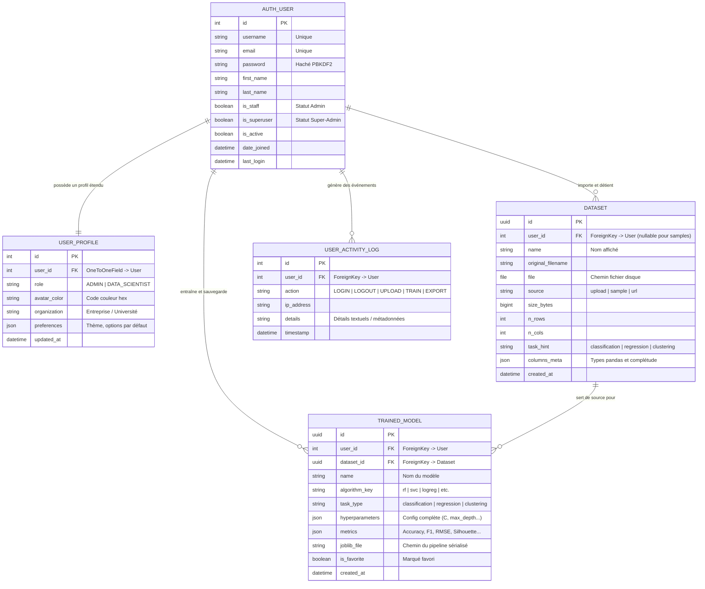

# 🗄️ Intégration Base de Données & Schéma Relationnel (100% DB-Linked)

> **Emplacement :** `planning/acteurs_planning/02_database_integration_and_models.md`  
> **Objectif :** Lier 100% des acteurs, données, sessions et modèles à la base de données relationnelle via l'ORM Django.  
> **Moteur DB :** SQLite en développement (`db.sqlite3`), prêt pour PostgreSQL en production.  
> **Intégrité référentielle :** Clés étrangères protégées, cascades strictes, migrations sans perte de données.

---

## 1. Schéma Relationnel des Données (Diagramme Entité-Relation)



---

## 2. Spécification des Modèles par Application

### 2.1 Modèle de Profil Utilisateur — `apps/accounts/models.py`

Le modèle Django natif `User` (`django.contrib.auth.models.User`) gère l'authentification et les mots de passe. Un modèle `UserProfile` relié par une relation `OneToOneField` stocke les informations contextuelles du Studio :

```python
# apps/accounts/models.py
import uuid
from django.db import models
from django.contrib.auth.models import User
from django.db.models.signals import post_save
from django.dispatch import receiver


class UserProfile(models.Model):
    """
    Profil étendu lié 1-à-1 avec l'utilisateur Django.
    """
    class RoleChoices(models.TextChoices):
        ADMIN = "ADMIN", "Administrateur Plateforme"
        USER = "USER", "Data Scientist / Membre"

    user = models.OneToOneField(User, on_delete=models.CASCADE, related_name="profile")
    role = models.CharField(
        max_length=20, 
        choices=RoleChoices.choices, 
        default=RoleChoices.USER
    )
    avatar_color = models.CharField(max_length=7, default="#B8323C") # Teinte Ume par défaut
    organization = models.CharField(max_length=150, blank=True, default="Laboratoire ML")
    preferences = models.JSONField(
        default=dict, 
        blank=True,
        help_text="Préférences utilisateur : notifications, graphiques par défaut, etc."
    )
    created_at = models.DateTimeField(auto_now_add=True)
    updated_at = models.DateTimeField(auto_now=True)

    def __str__(self):
        return f"Profil de {self.user.username} ({self.get_role_display()})"

    @property
    def initials(self) -> str:
        """Génère les initiales pour l'avatar (ex: John Doe -> JD)."""
        first = self.user.first_name[:1] if self.user.first_name else ""
        last = self.user.last_name[:1] if self.user.last_name else ""
        if not first and not last:
            return self.user.username[:2].upper()
        return f"{first}{last}".upper()


# Signal automatique : Crée un UserProfile dès qu'un User est inséré en base
@receiver(post_save, sender=User)
def create_or_save_user_profile(sender, instance, created, **kwargs):
    if created:
        role = UserProfile.RoleChoices.ADMIN if instance.is_staff else UserProfile.RoleChoices.USER
        UserProfile.objects.create(user=instance, role=role)
    else:
        if hasattr(instance, "profile"):
            instance.profile.save()
```

---

### 2.2 Évolution du Modèle `Dataset` — `apps/datasets/models.py`

Pour garantir le cloisonnement multi-utilisateurs en base de données, nous ajoutons le champ `user` en tant que `ForeignKey(User)` nullable pour préserver les datasets d'exemples préchargés (Iris, Titanic, Housing, Wine) :

```python
# apps/datasets/models.py
from django.conf import settings
from django.db import models

class Dataset(models.Model):
    # Clé primaire UUID existante
    id = models.UUIDField(primary_key=True, default=uuid.uuid4, editable=False)
    
    # ➕ NOUVEAU CHAMP : Liaison avec l'utilisateur propriétaire
    user = models.ForeignKey(
        settings.AUTH_USER_MODEL,
        on_delete=models.CASCADE,
        related_name="datasets",
        null=True,      # Permet aux datasets partagés (sample) de ne pas avoir de propriétaire unique
        blank=True,
        help_text="Propriétaire du dataset. Si vide, il s'agit d'un jeu de démonstration partagé."
    )
    
    name = models.CharField("nom affiché", max_length=200)
    original_filename = models.CharField(max_length=255, blank=True)
    file = models.FileField(upload_to="datasets/%Y/%m/")
    source = models.CharField(max_length=20, choices=Source.choices, default=Source.UPLOAD)
    ...
```

#### Règle de Cloisonnement dans les Requêtes ORM :
```python
# Pour un utilisateur standard :
user_datasets = Dataset.objects.filter(
    models.Q(user=request.user) | models.Q(source=Dataset.Source.SAMPLE)
)

# Pour un administrateur :
all_datasets = Dataset.objects.all().select_related("user")
```

---

### 2.3 Nouveau Modèle de Persistance ML — `apps/ml_engine/models.py`

Actuellement, les modèles entraînés étaient cantonnés aux sessions éphémères. L'ajout d'une table `TrainedModel` assure une persistance totale des entraînements dans la base de données :

```python
# apps/ml_engine/models.py
import uuid
from django.conf import settings
from django.db import models
from apps.datasets.models import Dataset


class TrainedModel(models.Model):
    """
    Sauvegarde persistante d'un modèle Machine Learning entraîné par un utilisateur.
    """
    id = models.UUIDField(primary_key=True, default=uuid.uuid4, editable=False)
    user = models.ForeignKey(
        settings.AUTH_USER_MODEL,
        on_delete=models.CASCADE,
        related_name="trained_models"
    )
    dataset = models.ForeignKey(
        Dataset,
        on_delete=models.SET_NULL,
        null=True,
        blank=True,
        related_name="models"
    )
    name = models.CharField(max_length=200, help_text="Ex: Random Forest Optimisé")
    algorithm_key = models.CharField(max_length=50) # 'random_forest', 'svm', 'logistic_regression'...
    task_type = models.CharField(max_length=30)     # 'classification', 'regression', 'clustering'
    
    hyperparameters = models.JSONField(default=dict, blank=True)
    metrics = models.JSONField(
        default=dict, 
        blank=True, 
        help_text="Score test, validation croisée, RMSE, F1, Silhouette..."
    )
    joblib_path = models.CharField(
        max_length=500, 
        blank=True, 
        help_text="Chemin d'accès au fichier .joblib sérialisé sur le disque"
    )
    is_favorite = models.BooleanField(default=False)
    created_at = models.DateTimeField(auto_now_add=True)

    class Meta:
        ordering = ["-created_at"]
        verbose_name = "modèle entraîné"
        verbose_name_plural = "modèles entraînés"

    def __str__(self):
        return f"{self.name} ({self.algorithm_key}) — {self.user.username}"
```

---

### 2.4 Journalisation des Actions (Audit Trail) — `apps/accounts/models.py`

Pour l'administrateur, cette table permet de monitorer l'activité de la plateforme sans complexité :

```python
class UserActivityLog(models.Model):
    class ActionChoices(models.TextChoices):
        LOGIN = "LOGIN", "Connexion réussie"
        LOGOUT = "LOGOUT", "Déconnexion"
        UPLOAD_DATASET = "UPLOAD_DATASET", "Import de dataset"
        TRAIN_MODEL = "TRAIN_MODEL", "Entraînement de modèle"
        EXPORT_REPORT = "EXPORT_REPORT", "Génération rapport PDF"
        DELETE_DATASET = "DELETE_DATASET", "Suppression de dataset"

    user = models.ForeignKey(User, on_delete=models.CASCADE, related_name="activity_logs")
    action = models.CharField(max_length=30, choices=ActionChoices.choices)
    ip_address = models.GenericIPAddressField(null=True, blank=True)
    details = models.CharField(max_length=255, blank=True)
    timestamp = models.DateTimeField(auto_now_add=True)

    class Meta:
        ordering = ["-timestamp"]
```

---

## 3. Plan d'Exécution des Migrations (Zéro Régression)

Pour appliquer ces modifications sans casser la base existante (`db.sqlite3`), la procédure s'exécute en 4 étapes séquentielles :

1. **Création de la nouvelle application Django `apps.accounts` :**
   ```bash
   .venv/bin/python manage.py startapp accounts apps/accounts
   ```
2. **Ajout de l'application dans `ml_studio/settings.py` :**
   ```python
   INSTALLED_APPS = [
       ...
       'apps.accounts.apps.AccountsConfig',
   ]
   ```
3. **Génération et exécution des migrations :**
   ```bash
   .venv/bin/python manage.py makemigrations accounts
   .venv/bin/python manage.py makemigrations datasets
   .venv/bin/python manage.py makemigrations ml_engine
   .venv/bin/python manage.py migrate
   ```
4. **Script de Rétro-Compatibilité (Data Migration) :**
   - Assigne automatiquement les datasets existants sans propriétaire au super-utilisateur ou les marque en `source="sample"` pour qu'ils soient consultables par tous.

