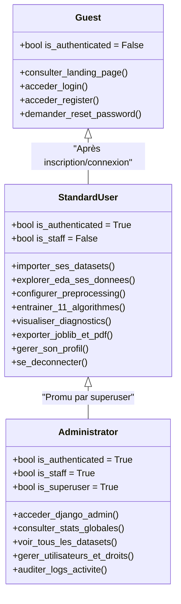

# 🛡️ Matrice RBAC, Permissions & Contrôle d'Accès

> **Emplacement :** `planning/acteurs_planning/03_roles_permissions_and_rbac.md`  
> **Objectif :** Définir et implémenter le contrôle d'accès basé sur les rôles (RBAC) pour isoler les données et sécuriser les vues.  
> **Mécanismes :** Décorateurs Python, Middleware Django, Templates contextuels.

---

## 1. Rôles et Niveaux d'Accès (RBAC)

Dans ML Studio, 3 niveaux d'autorisation strictement définis régissent la plateforme :



---

## 2. Matrice Exhaustive des Autorisations par Fonctionnalité

| Fonctionnalité / Vue | Endpoint / Action | 👁️ Guest | 👤 Standard User | 🛡️ Administrateur |
| :--- | :--- | :---: | :---: | :---: |
| **Landing Page** | `GET /` | ✅ Accès libre | ➡️ Redirigé `/dashboard/` | ➡️ Redirigé `/dashboard/` |
| **Connexion** | `GET/POST /auth/login/` | ✅ Accès libre | ➡️ Redirigé `/dashboard/` | ➡️ Redirigé `/dashboard/` |
| **Inscription** | `GET/POST /auth/register/` | ✅ Accès libre | ➡️ Redirigé `/dashboard/` | ➡️ Redirigé `/dashboard/` |
| **Déconnexion** | `POST /auth/logout/` | ❌ 403 / Redir | ✅ Purge session | ✅ Purge session |
| **Profil & Password** | `GET/POST /auth/profile/` | ❌ Redir login | ✅ Ses données uniquement | ✅ Ses données + Badge Admin |
| **Dashboard ML** | `GET /dashboard/` | ❌ Redir login | ✅ Vue utilisateur standard | ✅ Vue enrichie avec KPIs globaux |
| **Upload Dataset** | `POST /datasets/upload/` | ❌ Redir login | ✅ Lié à `request.user` | ✅ Lié à `request.user` |
| **Listing Datasets** | `GET /datasets/` | ❌ Redir login | ✅ Ses datasets + Démo | ✅ Tous les datasets de la DB |
| **Suppression Dataset**| `POST /datasets/<id>/delete/`| ❌ Redir login | ✅ Si propriétaire (`user=req.user`) | ✅ Tout dataset (modération) |
| **Exploration (EDA)** | `GET /eda/` | ❌ Redir login | ✅ Sur son dataset actif | ✅ Sur son dataset actif |
| **Prétraitement** | `GET/POST /preprocessing/` | ❌ Redir login | ✅ Sur son dataset actif | ✅ Sur son dataset actif |
| **Entraînement ML** | `POST /models/train/` | ❌ Redir login | ✅ Modèle lié à son compte | ✅ Modèle lié à son compte |
| **Leaderboard Modèles**| `GET /models/` | ❌ Redir login | ✅ Ses modèles sauvegardés | ✅ Ses modèles ou tous les modèles |
| **Export Joblib / PDF**| `GET /export/<id>/download/`| ❌ Redir login | ✅ Si propriétaire du modèle | ✅ Tout modèle |
| **Inférence Live** | `POST /export/predict/` | ❌ Redir login | ✅ Modèle actif | ✅ Modèle actif |
| **Panneau Admin** | `GET/POST /admin/` | ❌ Redir login | ⛔ Erreur 403 Forbidden | ✅ Accès total Django Admin |

---

## 3. Gardes d'Accès : Décorateurs & Middleware

### 3.1 Décorateurs Réutilisables — `apps/accounts/decorators.py`

```python
"""
Security decorators for ML Studio views.
"""

from functools import wraps
from django.contrib import messages
from django.contrib.auth.decorators import login_required
from django.core.exceptions import PermissionDenied
from django.shortcuts import redirect


def studio_login_required(view_func):
    """
    Vérifie que l'utilisateur est authentifié.
    Si non, redirige vers /auth/login/ avec message flash d'avertissement.
    """
    @wraps(view_func)
    def _wrapped_view(request, *args, **kwargs):
        if not request.user.is_authenticated:
            messages.warning(
                request, 
                "Vous devez être connecté pour accéder à l'espace de travail ML Studio."
            )
            return redirect(f"/auth/login/?next={request.path}")
        return view_func(request, *args, **kwargs)
    return _wrapped_view


def admin_required(view_func):
    """
    Vérifie que l'utilisateur est administrateur (is_staff ou is_superuser).
    Si non, lève une exception 403 PermissionDenied.
    """
    @wraps(view_func)
    def _wrapped_view(request, *args, **kwargs):
        if not request.user.is_authenticated:
            return redirect(f"/auth/login/?next={request.path}")
        if not (request.user.is_staff or request.user.is_superuser):
            raise PermissionDenied("Accès réservé aux administrateurs de ML Studio.")
        return view_func(request, *args, **kwargs)
    return _wrapped_view


def anonymous_only(view_func):
    """
    Empêche les utilisateurs déjà connectés de visiter /auth/login/ ou /auth/register/.
    Redirige automatiquement vers le dashboard.
    """
    @wraps(view_func)
    def _wrapped_view(request, *args, **kwargs):
        if request.user.is_authenticated:
            return redirect("core:dashboard")
        return view_func(request, *args, **kwargs)
    return _wrapped_view
```

---

### 3.2 Middleware Global de Sécurité — `apps/accounts/middleware.py`

Pour éviter d'oublier de protéger une vue manuellement avec `@studio_login_required`, un middleware global intercepte les requêtes :

```python
# apps/accounts/middleware.py
from django.shortcuts import redirect
from django.urls import resolve

# Routes publiques accessibles sans authentification
PUBLIC_NAMESPACES = {"accounts"}
PUBLIC_URL_NAMES = {"landing", "login", "register", "password_reset"}


class StudioAccessControlMiddleware:
    def __init__(self, get_response):
        self.get_response = get_response

    def __call__(self, request):
        resolver_match = resolve(request.path_info)
        url_name = resolver_match.url_name
        namespace = resolver_match.namespace

        # Vérifie si la route demandée est publique
        is_public = (
            request.path.startswith("/admin/") or
            request.path.startswith("/static/") or
            request.path.startswith("/media/") or
            url_name in PUBLIC_URL_NAMES or
            namespace in PUBLIC_NAMESPACES or
            request.path == "/"
        )

        if not is_public and not request.user.is_authenticated:
            return redirect(f"/auth/login/?next={request.path}")

        return self.get_response(request)
```

---

## 4. Enrichissement du Dashboard pour l'Administrateur

Lorsque l'acteur est un **Administrateur** (`request.user.is_staff`), la vue `dashboard_view` dans `apps/core/views.py` injecte des KPIs système exclusifs :

```python
# Extrait apps/core/views.py
from django.contrib.auth.models import User
from apps.datasets.models import Dataset
from apps.ml_engine.models import TrainedModel

def dashboard_view(request):
    context = {"state": request.session.get("project_state", {})}
    
    # 🛡️ Injection des statistiques pour l'Administrateur
    if request.user.is_staff:
        context["admin_stats"] = {
            "total_users": User.objects.count(),
            "active_users_7d": User.objects.filter(last_login__isnull=False).count(),
            "total_datasets": Dataset.objects.count(),
            "total_models": TrainedModel.objects.count(),
            "storage_used_bytes": sum(d.size_bytes for d in Dataset.objects.all()),
        }

    return render(request, "core/dashboard.html", context)
```

