# 📋 Feuille de Route & Checklist Opérationnelle d'Implémentation

> **Emplacement :** `planning/acteurs_planning/05_task_breakdown_and_checklist.md`  
> **Méthodologie :** Découpage en 6 Sprints séquentiels et incrémentaux.  
> **Principe directeur :** Zéro régression sur le studio existant, validation continue, persistance 100% DB.

---

## 🏃 Découpage en Sprints & Ordre d'Exécution

```mermaid
gantt
    title Feuille de Route d'Implémentation Authentification & Acteurs
    dateFormat  X
    axisFormat Sprint %s

    section Sprint 1 : Base DB & Modèles
    Création apps/accounts & Modèle UserProfile         :active, s1_1, 0, 1
    Liaison Dataset à User (ForeignKey)                :s1_2, 1, 2
    Modèle Persistance TrainedModel & ActivityLog      :s1_3, 2, 3
    Migrations Django & Script Rétrocompatibilité       :s1_4, 3, 4

    section Sprint 2 : Formulaires & Vues Auth
    Formulaires Django (Login, Register, Profile)       :s2_1, 4, 5
    Service Layer (authenticate, register, update)     :s2_2, 5, 6
    Vues HTTP (login, register, logout, profile)       :s2_3, 6, 7
    Endpoints HTMX (Vérification email / username)     :s2_4, 7, 8

    section Sprint 3 : Templates & UI Frontend
    Layout auth_base.html                              :s3_1, 8, 9
    Template /auth/login/ (Toggle mot de passe)        :s3_2, 9, 10
    Template /auth/register/ (Validation directe)      :s3_3, 10, 11
    Template /auth/profile/ (Statistiques & Édition)   :s3_4, 11, 12
    Modale de confirmation Logout (Alpine.js)          :s3_5, 12, 13

    section Sprint 4 : Intégration Interne du Site
    Context Processor (Utilisateur & Avatar)          :s4_1, 13, 14
    Pied de Sidebar (Carte utilisateur & Logout)       :s4_2, 14, 15
    Topbar (Menu déroulant profil & rôle Admin)        :s4_3, 15, 16

    section Sprint 5 : Sécurisation & Multi-Tenancy
    Décorateurs @studio_login_required & @admin_req    :s5_1, 16, 17
    Cloisonnement des datasets (filter par user)       :s5_2, 17, 18
    Dashboard Admin (KPIs globaux de la plateforme)    :s5_3, 18, 19
    Landing Page Vitrine (/)                           :s5_4, 19, 20

    section Sprint 6 : Tests & Validation
    Tests unitaires d'isolation des données            :s6_1, 20, 21
    Tests fonctionnels de sécurité (CSRF, Brute Force) :s6_2, 21, 22
    Revue de code & Documentation finale               :s6_3, 22, 23
```



---

## 📝 Checklist Détaillée par Tâche

### 🟢 SPRINT 1 : Socle Django & Architecture Base de Données (100% DB-Linked)
- [ ] **1.1 Initialisation de l'application Django `accounts`**
  - Commande : `.venv/bin/python manage.py startapp accounts apps/accounts`
  - Inscription dans `ml_studio/settings.py` (`apps.accounts.apps.AccountsConfig`).
- [ ] **1.2 Création du modèle `UserProfile` (`apps/accounts/models.py`)**
  - Champs : `user` (OneToOne), `role` (ADMIN, USER), `avatar_color`, `organization`, `preferences`.
  - Signal Django `post_save` pour générer automatiquement le profil lors de la création d'un utilisateur.
- [ ] **1.3 Liaison du modèle `Dataset` avec `User` (`apps/datasets/models.py`)**
  - Ajout du champ : `user = models.ForeignKey(settings.AUTH_USER_MODEL, on_delete=models.CASCADE, null=True, blank=True, related_name='datasets')`.
- [ ] **1.4 Création du modèle `TrainedModel` (`apps/ml_engine/models.py`)**
  - Champs : `id` (UUID), `user` (FK), `dataset` (FK), `name`, `algorithm_key`, `task_type`, `hyperparameters`, `metrics`, `joblib_path`.
- [ ] **1.5 Création du modèle d'audit `UserActivityLog` (`apps/accounts/models.py`)**
- [ ] **1.6 Génération et exécution des migrations Django :**
  ```bash
  .venv/bin/python manage.py makemigrations accounts
  .venv/bin/python manage.py makemigrations datasets
  .venv/bin/python manage.py makemigrations ml_engine
  .venv/bin/python manage.py migrate
  ```

---

### 🟢 SPRINT 2 : Formulaires, Services & Contrôleurs Auth
- [ ] **2.1 Conception des formulaires (`apps/accounts/forms.py`)**
  - `LoginForm` : Validation des identifiants (support username ou email).
  - `RegisterForm` : Validation d'unicité email/username, conformité des mots de passe.
  - `UserProfileForm` : Modification des informations personnelles.
  - `CustomPasswordChangeForm` : Sécurisation du changement de mot de passe.
- [ ] **2.2 Couche Service (`apps/accounts/services.py`)**
  - Fonction `authenticate_by_email_or_username(identifier, password)`.
  - Fonction `register_new_user(data) -> User`.
  - Fonction `log_user_activity(user, action, ip, details)`.
- [ ] **2.3 Vues Contrôleurs (`apps/accounts/views.py`)**
  - `login_view` : Gestion GET / POST avec paramètre `?next=` et "Se souvenir de moi".
  - `register_view` : Création de compte et connexion automatique immédiate.
  - `logout_view` : Déconnexion POST uniquement avec `request.session.flush()`.
  - `profile_view` : Consultation et mise à jour du profil.
- [ ] **2.4 Endpoints HTMX pour validation en direct**
  - `check_email` : Vérifie la disponibilité d'une adresse email sans rechargement.
  - `check_username` : Vérifie la disponibilité du nom d'utilisateur.
- [ ] **2.5 Routage d'URLs (`apps/accounts/urls.py` et `ml_studio/urls.py`)**
  - Déclaration de `path('auth/', include('apps.accounts.urls', namespace='accounts'))`.

---

### 🟢 SPRINT 3 : Frontend & Expérience Utilisateur (Tailwind, HTMX & Alpine.js)
- [ ] **3.1 Layout dédié `templates/layouts/auth_base.html`**
  - Fond `#111010`, carte épurée centrée `#1B1918`, typographie *Shippori Mincho*.
- [ ] **3.2 Page de connexion `templates/accounts/login.html`**
  - Toggle mot de passe en clair via Alpine.js (`showPassword = !showPassword`).
  - Alertes d'erreurs en cas de mot de passe incorrect.
- [ ] **3.3 Page d'inscription `templates/accounts/register.html`**
  - Vérification instantanée par HTMX (champs email et username).
  - Jauge de robustesse du mot de passe.
- [ ] **3.4 Page de profil `templates/accounts/profile.html`**
  - Cartes de statistiques personnelles (datasets, modèles, stockage).
  - Zone de danger avec confirmation de suppression de compte.
- [ ] **3.5 Modale de déconnexion `templates/components/logout_modal.html`**
  - Événement personnalisé Alpine.js `$dispatch('open-logout-modal')`.
  - Soumission sécurisée en POST avec protection CSRF.

---

### 🟢 SPRINT 4 : Intégration Interne dans le Studio (Sidebar & Topbar)
- [ ] **4.1 Context Processor Global (`apps/core/context_processors.py`)**
  - Injecte `user_initials`, `user_role_label`, et `is_admin` dans tous les templates DTL.
- [ ] **4.2 Mise à jour de la barre latérale (`templates/components/sidebar.html`)**
  - Ajout du widget utilisateur en bas de sidebar avec avatar circulaire coloré.
  - Badge dynamique : `ADMIN` (Rose/Ume) ou `MEMBRE` (Indigo).
  - Bouton déconnexion déclenchant la modale.
- [ ] **4.3 Mise à jour de l'en-tête supérieur (`templates/components/topbar.html`)**
  - Dropdown utilisateur Alpine.js avec raccourci Profil, Django Admin (si staff) et Déconnexion.
- [ ] **4.4 Inclusion de la modale de déconnexion dans `templates/base.html`**

---

### 🟢 SPRINT 5 : Cloisonnement Multi-Tenancy & Permissions RBAC
- [ ] **5.1 Implémentation des décorateurs (`apps/accounts/decorators.py`)**
  - `@studio_login_required` sur toutes les vues des apps `datasets`, `eda`, `preprocessing`, `ml_engine`, `model_viz`, `export_inference`.
  - `@admin_required` sur les routes de supervision.
- [ ] **5.2 Cloisonnement strict des requêtes Datasets (`apps/datasets/views.py`)**
  - Filtrage ORM : `Dataset.objects.filter(Q(user=request.user) | Q(source="sample"))`.
  - Attribution automatique de `user=request.user` lors de l'upload.
  - Restriction de suppression : seul le propriétaire ou un admin peut supprimer un fichier.
- [ ] **5.3 Persistance des modèles entraînés (`apps/ml_engine/trainer.py`)**
  - Création d'une instance `TrainedModel` en base dès qu'un algorithme termine son entraînement.
- [ ] **5.4 Tableau de bord enrichi pour l'Admin (`apps/core/views.py`)**
  - Si `request.user.is_staff` : affichage des statistiques globales (utilisateurs inscrits, total datasets, modèles générés, espace disque).
- [ ] **5.5 Landing Page d'accueil publique (`templates/core/landing.html`)**
  - Route `/` : Affiche la Landing Page si visiteur anonyme, redirige vers `/dashboard/` si utilisateur connecté.

---

### 🟢 SPRINT 6 : Vérification, Sécurité & Recette Finale
- [ ] **6.1 Création des comptes de test :**
  ```bash
  .venv/bin/python manage.py createsuperuser --username admin --email admin@mlstudio.local
  ```
  - Création de 2 utilisateurs standards (`user1`, `user2`).
- [ ] **6.2 Validation de l'isolation des données :**
  - `user1` uploade un dataset → vérifier que `user2` ne peut pas le voir ni l'utiliser.
  - `admin` peut visualiser l'ensemble des datasets et consulter les métriques globales.
- [ ] **6.3 Vérification de la sécurité CSRF et des sessions :**
  - La déconnexion en GET doit être refusée.
  - La session est totalement purgée après logout (`request.session.flush()`).
  - Toute tentative d'accès non authentifié renvoie vers `/auth/login/?next=...`.
- [ ] **6.4 Vérification responsive & console JS :**
  - Zéro erreur dans la console navigateur.
  - Parfaite adaptation mobile / desktop du menu et de la sidebar.

