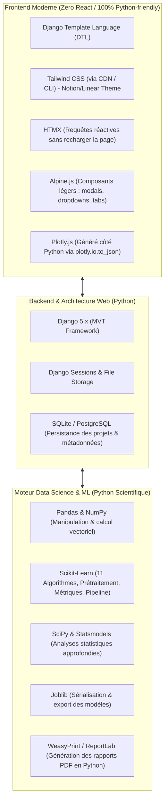
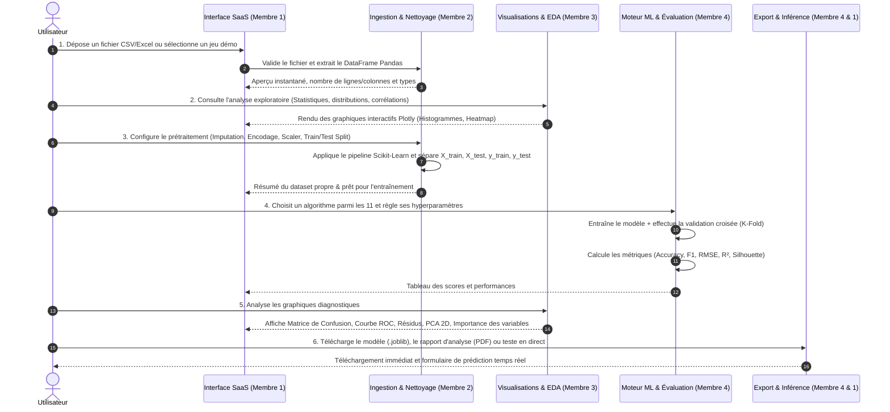
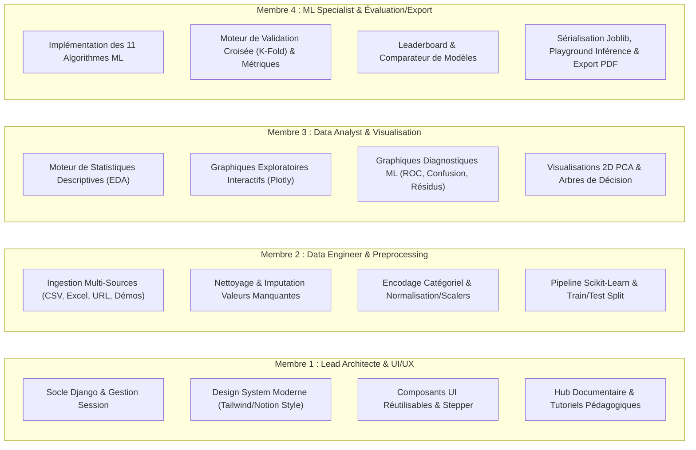
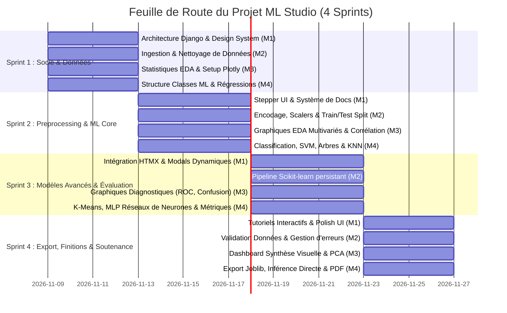

# 🚀 Master ML Studio — Plan Directeur & Spécifications du Projet (A à Z)

> **Projet de Fin de Module : Application Polyvalente de Machine Learning en Python**  
> **Niveau :** Master Informatique / Data Science & Intelligence Artificielle  
> **Équipe :** 4 Personnes  
> **Orientation Design :** Interface SaaS Moderne (Inspirée de **Notion**, **Linear**, et **n8n**)  
> **Contrainte Technologique Majeure :** Écosystème **100% Python**  

---

## 📑 Sommaire Exécutif

1. [Vision & Objectifs du Projet](#1-vision--objectifs-du-projet)
2. [Conformité au Cahier des Charges](#2-conformité-au-cahier-des-charges)
3. [Stack Technologique (100% Écosystème Python)](#3-stack-technologique-100-écosystème-python)
4. [Design System & Expérience Utilisateur (Notion / Linear / n8n Style)](#4-design-system--expérience-utilisateur-notion--linear--n8n-style)
5. [Architecture Globale & Arborescence du Code](#5-architecture-globale--arborescence-du-code)
6. [Pipeline Fonctionnel de Bout en Bout (Workflow)](#6-pipeline-fonctionnel-de-bout-en-bout-workflow)
7. [Répartition Équilibrée du Travail (Équipe de 4)](#7-répartition-équilibrée-du-travail-équipe-de-4)
8. [Planning des Sprints & Jalons de Livraison](#8-planning-des-sprints--jalons-de-livraison)
9. [Normes de Code, Git & Stratégie Valorisation CV](#9-normes-de-code-git--stratégie-valorisation-cv)

---

## 1. Vision & Objectifs du Projet

L'objectif de ce projet est de concevoir et développer une **plateforme web moderne, complète et clé en main d'AutoML / Machine Learning Studio**, développée intégralement en Python avec le framework **Django**.

Cette application permet à un utilisateur (étudiant, data analyst, ingénieur) d'importer un jeu de données, d'en explorer la distribution statistique, de le nettoyer et le normaliser, puis d'entraîner, évaluer, visualiser et exporter une suite exhaustive d'algorithmes de Machine Learning sans écrire une seule ligne de code côté client.

### Pourquoi ce projet est un atout majeur pour vos CV :
* **Qualité Production :** Architecture modulaire Django, séparation stricte des responsabilités (SOC), typage Python (`typing`), tests unitaires et documentation soignée.
* **UI/UX Grade SaaS :** Loin des interfaces académiques austères, l'application adopte les codes visuels des géants du logiciel moderne (Linear, Notion, n8n) : typographie chirurgicale, mode sombre natif, interactions fluides via HTMX sans complexité JavaScript superflue.
* **Exhaustivité Mathématique & Pratique :** Implémentation rigoureuse de 11 familles d'algorithmes, métriques d'évaluation fiables, visualisations interactives (Plotly) et export complet (modèles sérialisés `.joblib`, rapports PDF automatisés).

---

## 2. Conformité au Cahier des Charges

Le tableau suivant mappe chaque exigence du sujet avec la solution technique implémentée dans notre projet :

| Fonctionnalité Demandée (Sujet) | Implémentation dans notre Plateforme | Responsable Principal |
| :--- | :--- | :--- |
| **1. Interface Utilisateur Intuitive** | Dashboard Django avec stepper interactif (Upload → EDA → Preprocess → Model → Evaluation → Export), import CSV/Excel/JSON/URL et jeux de données de référence intégrés (Iris, Titanic, Housing, Wine). | **Membre 1** |
| **2. Représentation des Données** | Module EDA interactif : aperçu tabulaire paginé, typage automatique, statistiques descriptives (moyenne, écart-type, quartiles, asymétrie), matrice de corrélation dynamique, histogrammes et boxplots via Plotly. | **Membre 3** |
| **3. Gestion des Données** | Pipeline de nettoyage : imputation des valeurs manquantes (moyenne, médiane, mode, suppression), encodage catégoriel (One-Hot, Ordinal, Label), normalisation/standardisation (Standard, MinMax, Robust), train/test split stratifié. | **Membre 2** |
| **4. Algorithmes de Machine Learning** | Implémentation des 11 algorithmes demandés :<br>• **Régression Linéaire :** Simple, Multiple, Polynomiale.<br>• **Régression Logistique** (binaire et multi-classe).<br>• **Arbres de Décision** (classification et régression).<br>• **Naïf Bayésien** (Gaussian, Multinomial).<br>• **Support Vector Machine (SVM/SVR)**.<br>• **Random Forest** (classification et régression).<br>• **Plus Proche Voisin (KNN)**.<br>• **K-Means Clustering**.<br>• **Réseaux de Neurones Artificiels (MLP)**. | **Membre 4** |
| **5. Validation des Modèles** | Évaluation rigoureuse par validation croisée (K-Fold & Stratified K-Fold), calcul des métriques de pointe : MAE, MSE, RMSE, $R^2$, Accuracy, Précision, Rappel, F1-Score, ROC-AUC, Log-Loss, Silhouette Score (clustering). Leaderboard comparatif. | **Membre 4** |
| **6. Visualisation des Résultats** | Graphiques diagnostiques haute résolution (Plotly) : courbes d'ajustement (droites/polynômes), matrice de confusion interactive, courbes ROC/PR, résidus vs prédictions, projection PCA 2D pour K-Means, importance des features, convergence de perte du réseau de neurones. | **Membre 3** |
| **7. Exportation des Résultats** | Téléchargement du modèle entraîné (`.joblib` / `.pkl`), export des prédictions (CSV), rapport d'analyse complet téléchargeable (PDF / HTML automatisé) et bac à sable de prédiction en direct (Inference Playground). | **Membre 4** & **Membre 1** |
| **8. Documentation et Tutoriels** | Hub documentaire intégré inspiré de la documentation Notion : fiches théoriques pour chaque algorithme (intuition mathématique, hyperparamètres, cas d'usage, avantages/inconvénients) et tutoriels guidés interactifs pas à pas. | **Membre 1** |

---

## 3. Stack Technologique (100% Écosystème Python)

Pour respecter scrupuleusement la consigne du professeur (**"utiliser uniquement ce qui concerne Python"**), toute la logique applicative, le routage, le templating, les calculs ML et la génération graphique reposent sur l'écosystème Python :



### Détail des Composants Techniques :
* **Web Framework :** `Django 5.x` — Fournit une structure robuste, un ORM sécurisé, une gestion élégante des sessions et des fichiers, et une extensibilité parfaite.
* **Frontend Réactif sans Node.js :** `HTMX` permet d'exécuter des opérations asynchrones (ex: filtrer une colonne, changer d'hyperparamètre, lancer un entraînement) avec des fragments HTML retournés directement par Django. `Alpine.js` gère les micro-états de l'interface (menus, tiroirs, onglets).
* **Moteur Graphique :** `Plotly (Python)` permet de construire des visualisations complexes directement en Python et de les transmettre au template sous forme de payloads JSON interactifs (zoom, survol, masquage de séries).
* **Export PDF :** `WeasyPrint` ou `xhtml2pdf` (100% Python) pour convertir les templates HTML d'évaluation en rapports PDF professionnels prêts à imprimer.

---

## 4. Design System & Expérience Utilisateur (Notion / Linear / n8n Style)

Pour conférer à la plateforme une allure digne des meilleurs produits de la Silicon Valley, nous adoptons des principes de design épurés et haut de gamme :

### Palette de Couleurs (Mode Sombre / Mode Clair)
* **Dark Mode (Style Linear / n8n) :**
  * Fond principal : `#0d1117` ou `#0b0f19` (noir profond bleuté)
  * Cartes et conteneurs : `#161b22` ou `#1e293b`
  * Bordures subtiles : `#30363d` ou `#334155` (1px, élégant)
  * Texte principal : `#f0f6fc` / Texte secondaire : `#8b949e`
  * Accents interactifs : Indigo (`#6366f1`), Violet (`#8b5cf6`), Émeraude (`#10b981`)
* **Light Mode (Style Notion) :**
  * Fond principal : `#ffffff`
  * Fond secondaire : `#f7f7f5`
  * Typographie : Gris graphite foncé `#37352f`
  * Badges et étiquettes subtils avec coins arrondis doux (`rounded-lg` / `rounded-xl`).

### Composants Clés de l'Interface
1. **Sidebar Navigation (Style Notion) :** Menu latéral repliable affichant les étapes du workflow, la liste des datasets récents, et le centre documentaire.
2. **Stepper Horizontal (Fil d'Ariane n8n) :** Indicateur visuel d'avancement :
   `1. Ingestion` ➔ `2. Analyse EDA` ➔ `3. Prétraitement` ➔ `4. Modélisation` ➔ `5. Visualisation` ➔ `6. Export & Prédiction`.
3. **Tableaux de Données Riches :** Tableau interactif avec pagination, tri par colonne, badges de types de données (`int`, `float`, `object`, `category`), et indicateurs visuels de valeurs manquantes (barres de complétude).
4. **Tiroir d'Hyperparamètres (Drawer Linear) :** Volet latéral coulissant pour configurer finement les paramètres de chaque modèle (ex: nombre d'arbres, profondeur max, type de noyau SVM, pas d'apprentissage, couches cachées du réseau de neurones).
5. **Console de Logs en Direct :** Boîte d'exécution affichant le statut de l'entraînement, la convergence de la fonction de perte et le temps d'exécution en millisecondes.

---

## 5. Architecture Globale & Arborescence du Code

Le projet est structuré selon les standards industriels Django, découpé en applications modulaires correspondant aux spécialités de l'équipe :

```text
projet_ML/
├── manage.py
├── requirements.txt
├── README.md
├── planning/                               # Dossier de planification et spécifications
│   ├── main_explication.md                 # Document de synthèse général (ce fichier)
│   ├── member_1_architecture_ui_docs.md    # Cahier des charges Membre 1
│   ├── member_2_data_ingestion_preprocessing.md # Cahier des charges Membre 2
│   ├── member_3_eda_visualizations.md      # Cahier des charges Membre 3
│   └── member_4_ml_engine_evaluation_export.md # Cahier des charges Membre 4
├── ml_studio/                              # Cœur de configuration Django
│   ├── __init__.py
│   ├── settings.py                         # Configuration globale, static, media, session
│   ├── urls.py                             # Routage principal
│   ├── wsgi.py
│   └── asgi.py
├── apps/                                   # Applications Django modulaires
│   ├── core/                               # Membre 1 : Layout, Dashboard, Workspace Session
│   │   ├── views.py
│   │   ├── urls.py
│   │   └── context_processors.py
│   ├── datasets/                           # Membre 2 : Import, Gestion, Stockage Datasets
│   │   ├── models.py                       # Modèle de persistance des fichiers de données
│   │   ├── services.py                     # Lecteurs CSV, Excel, JSON, benchmark loaders
│   │   ├── views.py
│   │   └── urls.py
│   ├── preprocessing/                      # Membre 2 : Nettoyage, Imputation, Encodage, Scalers
│   │   ├── pipeline.py                     # Moteur de transformation Scikit-Learn
│   │   ├── views.py
│   │   └── urls.py
│   ├── eda/                                # Membre 3 : Profiling de données, Stats, Graphiques EDA
│   │   ├── stats_engine.py                 # Calculs descriptifs (Skew, Kurtosis, Corr)
│   │   ├── plot_factory.py                 # Créateur de graphiques Plotly (Distributions, Heatmaps)
│   │   ├── views.py
│   │   └── urls.py
│   ├── ml_engine/                          # Membre 4 : 11 Algorithmes, Entraînement, Validation
│   │   ├── algorithms/                     # Classes wrappers pour chaque algorithme
│   │   │   ├── regression.py               # Simple, Multiple, Polynomiale
│   │   │   ├── classification.py           # Logistique, Arbre, Forêt, SVM, KNN, Naïf Bayes
│   │   │   ├── clustering.py               # K-Means, Elbow, Silhouette
│   │   │   └── neural_network.py           # Réseau de neurones artificiels (MLP)
│   │   ├── trainer.py                      # Orchestrateur d'entraînement & Cross-Validation
│   │   ├── metrics.py                      # Moteur de calcul des métriques d'évaluation
│   │   ├── views.py
│   │   └── urls.py
│   ├── model_viz/                          # Membre 3 : Visualisation avancée des résultats
│   │   ├── diagnostic_plots.py             # ROC, Confusion Matrix, Résidus, Arbres, PCA 2D
│   │   ├── views.py
│   │   └── urls.py
│   ├── export_inference/                   # Membre 4 (+ Membre 1) : Export Joblib, Inférence, PDF
│   │   ├── exporter.py                     # Sérialisation et génération des rapports PDF
│   │   ├── predictor.py                    # Bac à sable de prédiction dynamique
│   │   ├── views.py
│   │   └── urls.py
│   └── docs_tutorials/                     # Membre 1 : Documentation & Guides interactifs
│       ├── content/                        # Markdown / fiches théoriques des 11 algorithmes
│       ├── views.py
│       └── urls.py
├── static/                                 # Ressources statiques partagées
│   ├── css/                                # Tailwind output / Custom dark-mode styles
│   ├── js/                                 # HTMX, Alpine.js, scripts utilitaires
│   └── img/                                # Logos, illustrations pédagogiques
├── templates/                              # Gabarits HTML (Django Template Language)
│   ├── base.html                           # Squelette principal (Sidebar, Header, Toasts)
│   ├── components/                         # Composants réutilisables (cards, badges, modals, charts)
│   ├── core/                               # Vues d'accueil & sélection de workspace
│   ├── datasets/                           # Vues d'import & preview
│   ├── eda/                                # Vues de profiling et graphiques exploratoires
│   ├── preprocessing/                      # Vues de configuration des filtres de nettoyage
│   ├── ml_engine/                          # Vues de sélection de modèle & hyperparamètres
│   ├── model_viz/                          # Vues d'évaluation & graphiques de performance
│   ├── export_inference/                   # Vues de téléchargement et bac à sable de prédiction
│   └── docs_tutorials/                     # Vues du centre documentaire et tutoriels
├── media/                                  # Répertoire de stockage des uploads et exports temporaires
│   ├── datasets/
│   ├── exported_models/
│   └── pdf_reports/
└── sample_data/                            # Jeux de données d'exemple préinstallés
    ├── iris.csv
    ├── titanic.csv
    ├── housing.csv
    └── customer_segmentation.csv
```

---

## 6. Pipeline Fonctionnel de Bout en Bout (Workflow)

L'utilisateur traverse un parcours fluide et cohérent en 6 étapes :



---

## 7. Répartition Équilibrée du Travail (Équipe de 4)

La charge de travail a été divisée de façon rigoureusement équitable, assurant que chaque membre développe une composante essentielle combinant logique Python, traitement de données, interface et intégration :



### Synthèse des Responsabilités par Membre :

| Membre | Rôle Clé | Modules Principaux | Livrables Majeurs | Fichier Dédié |
| :--- | :--- | :--- | :--- | :--- |
| **Membre 1** | **Tech Lead, Architecte Django & Designer UI/UX** | `core`, `docs_tutorials`, Architecture globale, Intégration frontend | • Projet Django configuré et documenté<br>• Interface responsive style Notion/Linear avec Dark Mode<br>• Navigation globale, Stepper interactif et gestion de projet<br>• Section Documentation et Tutoriels interactifs des 11 algorithmes | [`member_1_architecture_ui_docs.md`](file:///home/yaasin-ayadi/Master/Python/projet_ML/planning/member_1_architecture_ui_docs.md) |
| **Membre 2** | **Ingénieur Données & Pipeline de Prétraitement** | `datasets`, `preprocessing` | • Module d'import universel (CSV, XLSX, URL, jeux démo)<br>• Outils de nettoyage (valeurs nulles, doublons, types)<br>• Moteur d'encodage (One-Hot, Ordinal) et normalisation (Standard, MinMax, Robust)<br>• Séparation Train/Test avec persistance du pipeline | [`member_2_data_ingestion_preprocessing.md`](file:///home/yaasin-ayadi/Master/Python/projet_ML/planning/member_2_data_ingestion_preprocessing.md) |
| **Membre 3** | **Spécialiste EDA & Visualisation Interactive** | `eda`, `model_viz` | • Moteur de calculs statistiques univariés et bivariés<br>• Graphiques interactifs EDA (distributions, corrélations, boxplots)<br>• Graphiques de performance ML (ROC-AUC, Matrice de confusion, Résidus, Courbe K-Means Elbow)<br>• Visualisations avancées (projections PCA 2D/3D et importance des variables) | [`member_3_eda_visualizations.md`](file:///home/yaasin-ayadi/Master/Python/projet_ML/planning/member_3_eda_visualizations.md) |
| **Membre 4** | **Ingénieur Machine Learning & Évaluation/Inférence** | `ml_engine`, `export_inference` | • Implémentation complète des 11 algorithmes requis<br>• Moteur de validation croisée et calcul exhaustif des métriques de classification, régression et clustering<br>• Tableau comparatif des modèles (Leaderboard)<br>• Exportation des modèles (`.joblib`), générateur de rapport PDF et Playground de prédiction en direct | [`member_4_ml_engine_evaluation_export.md`](file:///home/yaasin-ayadi/Master/Python/projet_ML/planning/member_4_ml_engine_evaluation_export.md) |

---

## 8. Planning des Sprints & Jalons de Livraison

Le développement est structuré en **4 Sprints** logiques pour garantir une convergence sans heurts :



---

## 9. Normes de Code, Git & Stratégie Valorisation CV

### Convention Git
* Branche principale protégée : `main`
* Branche d'intégration : `develop`
* Branches de fonctionnalités standardisées :
  * `feature/m1-ui-core-layout`
  * `feature/m2-data-preprocessing`
  * `feature/m3-eda-plotly-viz`
  * `feature/m4-algorithms-evaluation`
* Commits sémantiques : `feat: ...`, `fix: ...`, `docs: ...`, `refactor: ...`, `test: ...`.

### Standards de Code Python (PEP 8 & Typage)
* Utilisation systématique des annotations de types Python (`typing` : `List`, `Dict`, `Tuple`, `Optional`, `Union`).
* Docstrings claires au format Google pour chaque fonction et classe.
* Gestion rigoureuse des exceptions (ex: division par zéro, colonnes avec types incompatibles, matrices singulières dans les régressions).

### Comment Valoriser ce Projet sur Votre CV et LinkedIn
Ce projet démontre des compétences très recherchées sur le marché actuel :
1. **Full-Stack Data Science :** Capacité à construire un produit d'IA complet, de la manipulation de données brutes jusqu'à l'interface utilisateur.
2. **Maîtrise Algorithmique :** Compréhension approfondie et capacité d'ajustement de 11 algorithmes classiques et modernes de Machine Learning.
3. **Software Craftsmanship :** Architecture logicielle propre en Django, code modulaire et réutilisable, intégration d'outils modernes comme HTMX et Tailwind CSS.
4. **Data Storytelling & UX :** Capacité à rendre des concepts mathématiques complexes compréhensibles et exploitables grâce à des visualisations interactives soignées.

